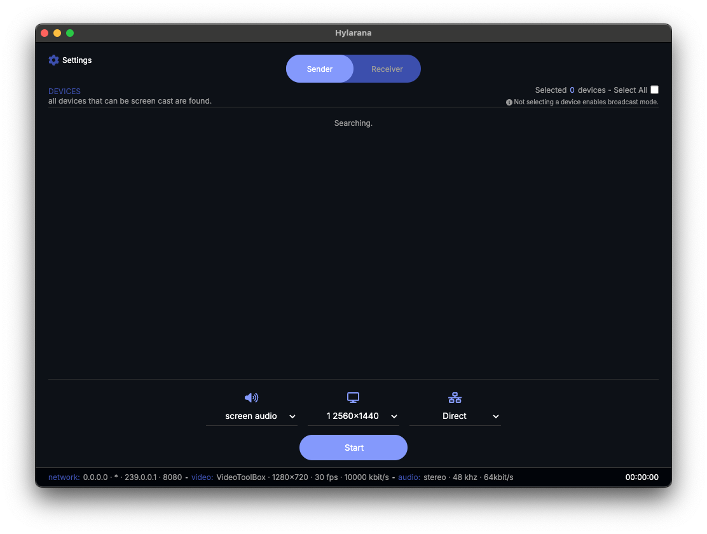

<!--lint disable no-literal-urls-->
<div align="center">
    
    <br>
    <br>
    <h1>Nayutacast</h1>
</div>
<div align="center">
    <strong>A high-performance, low-latency cross-platform screen casting toolkit implemented in Rust.</strong>
</div>
<div align="center">
    
    
    
    
</div>
<br/>
<br/>
<div align="center">
    
    <span>This is a screen casting application implemented using the Nayutacast SDK.</span>
</div>
<br/>

## Introduction

Unlike implementations such as Miracast or AirPlay that rely heavily on specialized hardware support (Wi-Fi Direct), **Nayutacast** works on standard commodity network hardware.

Nayutacast is cross-platform, supporting Windows, macOS, Linux, and Android. Unlike traditional DLNA streaming, Nayutacast prioritizes ultra-low latency (80–250ms end-to-end depending on platform and hardware encoders) while keeping an intuitive, unified API.

Nayutacast also supports direct SRT transmission, UDP multicast, and high-concurrency relay forwarding modes.

## Technical Overview

- **Screen Capture**: Platform-native capture pipelines with hardware-accelerated textures:
  - Windows: Windows Graphics Capture (WGC / D3D11)
  - macOS: ScreenCaptureKit
  - Linux: PipeWire (Wayland) / X11 XRandR fallback
  - Android: MediaProjection / VirtualDisplay
- **Audio & Video Codecs**:
  - Video: H.264 / H.265 (OpenH264, x264, Intel QSV, NVIDIA NVENC, macOS VideoToolBox, VAAPI)
  - Audio: AAC / Opus
- **Transport**:
  - SRT (Secure Reliable Transport) for direct 1-to-1 low-latency streaming
  - UDP Multicast for 1-to-many LAN broadcasting
  - Relay mode for high-concurrency or NAT traversal
- **Renderer**:
  - GPU-accelerated rendering powered by WebGPU (`wgpu`) supporting RGBA, BGRA, NV12, and I420 textures.

## Project Structure

```
nayutacast/
├── common/          # Shared types, logging, runtime utilities
├── codec/           # FFmpeg-based audio/video encoders and decoders
├── capture/         # Screen, camera, and audio capture (Windows, macOS, Linux)
├── renderer/        # GPU rendering with wgpu
├── transport/       # Transport layer (SRT, UDP multicast, relay)
├── discovery/       # Service discovery with libp2p / mDNS
├── resample/        # Native audio resampling and texture scaling
├── nayutacast/      # Main high-level SDK crate
├── server/          # Relay forwarding server
├── examples/        # CLI sender/receiver example
├── android/         # Android SDK library (Kotlin + JNI)
└── app/             # Desktop application (CEF + winit) & Android app
```

## Build Instructions

### Requirements

- **Rust**: 1.85+ stable
- **C/C++ Compiler**: Clang / GCC / MSVC (C++20 compliant)
- **CMake**: 3.16+
- **FFmpeg**: 6.x / 7.x development libraries

#### Linux (Ubuntu / Debian)

```bash
sudo apt-get update
sudo apt-get install -y build-essential pkg-config clang cmake tclsh \
    libssl-dev libpipewire-0.3-dev libva-dev libx11-dev libxrandr-dev \
    libxfixes-dev libxdamage-dev libv4l-dev libasound2-dev libglib2.0-dev \
    libavcodec-dev libavutil-dev libavdevice-dev libswresample-dev
```

#### macOS

```bash
brew install cmake ffmpeg@7
```

### Build Workspace

```bash
cargo check --workspace
cargo build --release
```

## License

LGPL-2.1-only
