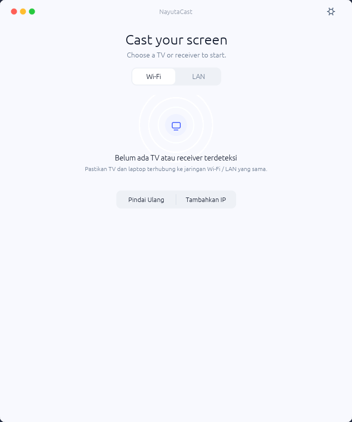
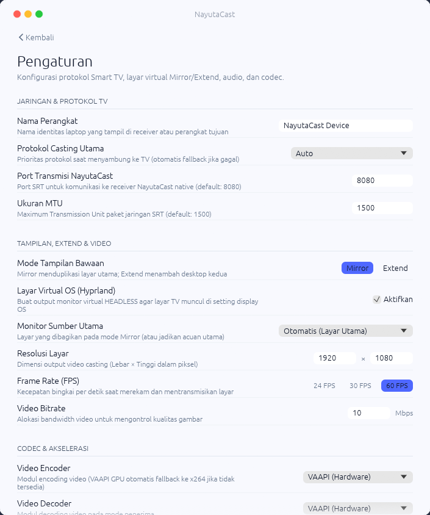

<!--lint disable no-literal-urls-->
<div align="center">
    
    <br/>
    <br/>
    <h1>NayutaCast</h1>
    <strong>High-performance, low-latency cross-platform screen casting toolkit &amp; 100% native Rust Smart TV casting application.</strong>
</div>

<br/>

<div align="center">
    <a href="https://github.com/Zeinkunn/NayutaCast/blob/main/LICENSE"></a>
    <a href="https://github.com/Zeinkunn/NayutaCast/commits/main"></a>
    <a href="https://github.com/Zeinkunn/NayutaCast/stargazers"></a>
    
</div>

<br/>

<div align="center">
<table>
  <tr>
    <td align="center"><strong>Scanner (Wi-Fi / LAN / Manual IP)</strong></td>
    <td align="center"><strong>Live Casting &amp; OS Display Mirror/Extend</strong></td>
    <td align="center"><strong>Settings &amp; Codec Controls</strong></td>
  </tr>
  <tr>
    <td align="center"></td>
    <td align="center"></td>
    <td align="center"></td>
  </tr>
</table>
</div>

---

## Introduction

**NayutaCast** works over standard commodity Wi-Fi and LAN networks without requiring specialized Wi-Fi Direct hardware. In addition to its low-latency Rust SDK (`SRT`, `UDP Multicast`, and `Relay` forwarding), NayutaCast includes a **100% native Rust desktop application** (`eframe` / `egui`) with **Universal Smart TV support** and **OS Virtual Display management (`Mirror` / `Extend`)**.

## Key Features

### 100% Native Rust Desktop UI (`app/desktop`)
- Built directly in Rust using [`eframe`](https://crates.io/crates/eframe) and [`egui`](https://crates.io/crates/egui) — no Chromium/CEF, Node.js, or Electron runtime overhead.
- Includes animated splash screen, automatic **Wi-Fi / LAN** TV scanner, manual IP protocol probe modal, live screen preview, and settings persistence.

### Universal Smart TV Casting Protocols
- **Google Cast v2**: Casts to Android TV, Google TV, and Chromecast devices over TLS (`8009`, default receiver `CC1AD845`).
- **DLNA / UPnP (`AVTransport:1`)**: Works with Samsung Tizen, LG webOS, Sony, Hisense, and generic UPnP renderers, while filtering out non-TV router/IGD advertisements.
- **Apple AirPlay (`7000`) & Roku ECP (`8060`)**: Built-in protocol sessions alongside automatic fallback probing.
- **Embedded HTTP Live Streaming & Browser TV (`/watch`)**: Serves live MPEG-TS (`/live.ts`, `/live.mpeg`), fragmented MP4 (`/live.mp4`), rolling HLS (`/live.m3u8`, `/seg_<n>.ts`), and a zero-install HTML5 `/watch` page for any Smart TV browser.
- **NayutaCast Native SRT**: Ultra-low-latency direct casting between NayutaCast peers discovered via libp2p (`nayutacast-app-core`), tracking real receiver connection counts before marking sessions active.

### OS Virtual Display (`Mirror` / `Extend`)
- On Linux/Hyprland, NayutaCast creates a virtual `HEADLESS-*` monitor output (`VirtualDisplayGuard`) that appears natively inside your OS **Display Settings**.
- Switch live between **Mirror** (duplicate your main screen) and **Extend** (second desktop monitor) even while casting.
- Persists virtual display state (`$XDG_RUNTIME_DIR/nayutacast-headless.state`) for crash recovery and automatically removes the virtual monitor when casting stops or the app exits.

### Capture, Codecs & Rendering
- **Screen & Camera Capture**:
  - **Windows**: Windows Graphics Capture (WGC / D3D11)
  - **macOS**: ScreenCaptureKit
  - **Linux**: Wayland `wlr-screencopy`, PipeWire XDG Desktop Portal, `X11` (`MIT-SHM`), and `V4L2` camera capture
  - **Android**: MediaProjection / VirtualDisplay
- **Audio Capture**: PipeWire system audio monitor capture (`STREAM_CAPTURE_SINK`) with `cpal` fallback and native resampling.
- **Audio & Video Codecs**: H.264 / H.265 (`x264`, Linux `VAAPI` with automatic `libx264` fallback, `NVENC`, `Intel QSV`, `VideoToolBox`, `OpenH264`) and `AAC` / `Opus`, multiplexed simultaneously into MPEG-TS, HLS, and fMP4 via `UniversalLiveMuxer`.
- **GPU Rendering**: Hardware-accelerated `wgpu` rendering supporting `RGBA`, `BGRA`, `NV12`, and `I420`.

## Project Structure

```text
NayutaCast/
├── common/          # Shared types, logging, codec/transport configuration
├── codec/           # FFmpeg encoders/decoders, VAAPI/x264, UniversalLiveMuxer (TS/HLS/fMP4)
├── capture/         # Screen, audio, camera & Linux VirtualDisplayGuard (wlr-screencopy, PipeWire, X11, WGC, SCK)
├── renderer/        # GPU rendering powered by wgpu
├── transport/       # Network transport layer (SRT with client tracking, UDP multicast, relay)
├── discovery/       # Peer discovery via libp2p / mDNS
├── resample/        # Native audio resampling and frame scaling
├── nayutacast/      # High-level cross-platform Rust SDK crate
├── server/          # Relay forwarding server
├── examples/        # CLI sender/receiver example
├── android/         # Android SDK library (Kotlin + JNI)
├── docs/images/     # Application screenshots
└── app/
    ├── desktop/     # 100% Native Rust desktop application (eframe / egui + Smart TV backends)
    └── android/     # Android client application
```

## Build & Run Instructions

### Requirements

- **Rust**: `1.85+` (stable, 2024 edition)
- **C/C++ Compiler**: Clang / GCC / MSVC (C++20 compliant)
- **CMake**: `3.16+`
- **FFmpeg**: `6.x` / `7.x` development libraries

#### Linux (Ubuntu / Debian)

```bash
sudo apt-get update
sudo apt-get install -y build-essential pkg-config clang cmake tclsh \
    libssl-dev libpipewire-0.3-dev libva-dev libx11-dev libxrandr-dev \
    libxfixes-dev libxdamage-dev libv4l-dev libasound2-dev libglib2.0-dev \
    libavcodec-dev libavutil-dev libavdevice-dev libswresample-dev
```

#### macOS

```bash
brew install cmake ffmpeg@7
```

### Run the Native Desktop App

```bash
cargo run -p nayutacast-app
# or via launcher script (Linux Wayland/X11)
./run_native_app.sh
```

### Build & Test Workspace

```bash
cargo check --workspace
cargo build --release -p nayutacast-app
cargo test -p nayutacast-capture --lib
cargo test -p nayutacast-codec --lib
cargo test -p nayutacast-app --bins
```

## License

LGPL-2.1-only
